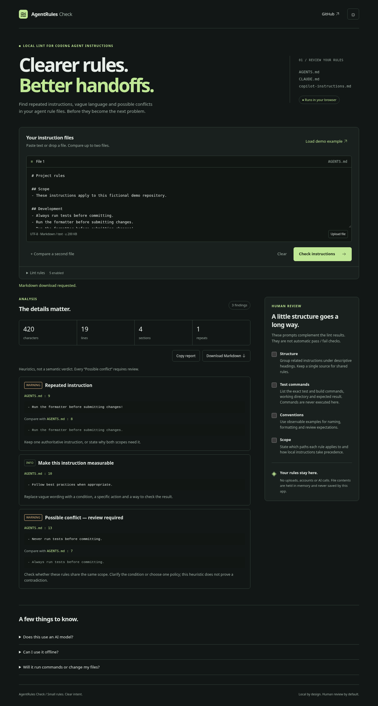

# AgentRules Check

**Local lint for coding agent instructions.** A small, client-side review tool for developers maintaining AGENTS.md, CLAUDE.md or copilot-instructions.md. It highlights repetition, vague language and potential policy conflicts without sending rules to a model.



[Mobile screenshot, light theme](docs/screenshots/mobile.png). These screenshots are generated from the real production app by the browser tests, using fictional instructions.

## What works

- Paste Markdown, upload a UTF-8 `.md`, `.markdown` or `.txt` file, or drag one onto each input panel.
- Compare two documents with findings linked to the appropriate source file and physical line. This is a combined lint review, not a visual diff.
- Count Unicode characters, physical lines, Markdown sections and repeated instructions (each occurrence after the first). Repeats are counted by the enabled duplicate rule.
- Enable or disable individual rules: normalized duplicates, vague language, missing headings, possible always/never conflicts, and long documents.
- See the original evidence, related evidence, severity and a concrete suggestion for every finding. Click a file/line button to focus its source context.
- Review a structure, test commands, conventions and scope checklist. Copy or download a Markdown report including a reusable, unchecked checklist.
- Use dark or light themes, keyboard controls, a skip link and announced progress/errors. Findings render 30 at a time with a working “Show next findings” control; exports include every finding.
- Analyze offline. The production build caches its static assets on first load; after installation, even an offline reload works. No content is persisted.

## Run locally

Use Node **22.12+** (Node 24 recommended) and npm. No environment variables, credentials or external services are required.

```sh
npm ci
npm run dev
```

Open the address printed by Vite. `npm ci` installs the exact dependency graph in `package-lock.json`. If your machine's default npm cache is not writable, use `npm ci --cache /tmp/agent-rules-npm-cache`.

```sh
npm run lint
npm test
npm run build
npm run preview
```

`lint` checks strict TypeScript and Prettier formatting, rather than an ESLint ruleset. `build` type-checks, bundles the app and generates a versioned offline worker from the exact output files. `preview` serves that production output; offline behavior is intentionally absent from the development server.

### Browser tests

```sh
npx playwright install chromium
npm run build
npm run test:e2e
npm run test:cache
```

On Linux CI, use `npx playwright install --with-deps chromium` to install required OS libraries too. Alternatively, use an existing Chromium installation:

```sh
CHROMIUM_PATH=/usr/bin/chromium npm run test:e2e
```

Playwright starts and stops its own preview server on port 4173. Browser tests cover import/drop, two-file analysis, rule toggles, line focus, literal HTML rendering, invalid input, copy/download, clipboard failure, offline reload, keyboard navigation, no document-triggered external requests, widths 360/768/1280 and axe WCAG A/AA checks. Automated accessibility checks do not replace assistive-technology testing.

See [verification and manual demo](docs/verification.md) for exact outcomes and repeatable steps.

## Fictional example

```markdown
# Project rules

## Development

- Run the formatter before submitting changes.
- Run the formatter before submitting changes!
- Follow best practices when appropriate.
- Always run tests before committing.
- Never run tests before committing.
```

This produces one repeated instruction, one vague-language suggestion and one **Possible conflict — review required**. The built-in demo includes scoped sections and a fenced command example; commands inside fences are ignored by instruction rules.

## Privacy and safety

Analysis runs in browser memory. There is no backend, analytics, remote model, remote font or automatic GitHub API request. Markdown is displayed as React text, without HTML rendering, linkification, `eval` or command execution. Exported evidence escapes Markdown and HTML control characters so it does not become active markup in a report viewer.

Actual network activity:

- Development/install: npm downloads packages; optional Playwright installation downloads a browser. Vite uses its local development websocket.
- Production app: the browser fetches HTML, JavaScript, CSS, favicon and `sw.js` from the same hosting origin. The service worker fetches those same assets to fill its versioned cache and the browser may check for worker updates. No rule content or filename is included in these requests.
- Clicking the GitHub link explicitly navigates to the existing repository. The hosting provider may have its own access logs; this app adds no tracking.

Only the theme choice (`arc-theme`) is saved in localStorage. The offline cache holds application assets, never instruction files or reports. Reloading clears the in-memory inputs; the app does not explicitly persist them, although browser session restoration or extensions may retain form data. Copy writes the report to your system clipboard; downloading saves it wherever your browser normally puts downloads. Remove sensitive reports from those places yourself.

The offline worker needs HTTPS or localhost and storage permission. First-time access requires a connection; wait for `navigator.serviceWorker.ready` in browser devtools before disconnecting. Blocked service workers or storage do not prevent local analysis in an already loaded tab, but they prevent offline reopening. Caches are isolated by service-worker scope. A new deployment takes over after old app tabs close; retain old hashed assets during rollout where your host supports that. Clear site data to reset caches and theme.

## Heuristics and limits

- At most two files, **200 KiB / 204,800 UTF-8 bytes per file**. Larger files are rejected explicitly, never silently truncated. Invalid UTF-8 and binary NUL are rejected. CRLF and CR line endings normalize to LF for physical line numbering; character totals count original input Unicode code points, including original line terminators.
- The parser recognizes ATX/setext headings, bullet/numbered list markers and backtick/tilde fences. All other nonempty prose lines are instruction candidates. It is not a full CommonMark parser: blockquotes, indented code, multiline list items and embedded scopes are not semantically interpreted. Only fenced code is guaranteed excluded.
- Duplicate normalization handles Unicode NFKC, casing, spaces and common punctuation. Path separators, internal dots, hyphens and underscores remain significant. Short fragments under 12 normalized characters are ignored. Scope can still make repetition intentional.
- Conflicts only match instructions beginning with `Always` or `Never` (optionally `Please`) whose remaining text matches after case/whitespace/trailing sentence-punctuation normalization. Targets, paths, word order and qualifiers must match. Different targets are not flagged. This deliberately misses paraphrases, negation and many genuine conflicts. Even a match can be valid in different scopes: **it is never proof of a semantic contradiction**.
- Vague-language detection uses a small English phrase list. Other languages and multiline meaning are outside v1. A long-document note appears above 12,000 JavaScript code units; length is a review prompt, not a quality verdict.
- No lint findings is not a safety, security or correctness guarantee. This is not a security scanner or universal validator.

## Code map

- `src/lib/markdownLines.ts`: bounded input, strict UTF-8 decoding and line/fence parser.
- `src/lib/ruleDefinitions.ts`: independent, switchable heuristic rules.
- `src/lib/lintRules.ts`: analysis orchestration, metrics and checklist guidance.
- `src/lib/markdownReport.ts`: inert Markdown export and local download.
- `src/components/`: inputs, findings, source context and human checklist.
- `scripts/generate-sw.mjs`: build-time offline asset manifest; no runtime content caching.
- `tests/`: unit tests and browser workflow checks.

React provides accessible, explicit UI state; Tailwind CSS v4 is integrated through Vite, with a small custom token-based stylesheet for the two themes. Vitest tests pure functions, Playwright tests the real production app and axe checks accessibility. Prettier keeps the small modules consistent. There are no production dependencies besides React and React DOM.

## Deploy and repository identity

The checkout's existing origin is `uemmebi/AgentRules-Check`; `umbertocodes/agent-rules-check` is an unverified suggested name, not a created repository. Update the header's GitHub link and these instructions if you intentionally move repositories. No public demo URL is claimed.

1. Run the checks above and review the real screenshots.
2. Review repository contents before publishing. This project is licensed under the [MIT License](LICENSE).
3. Push the project to the intended GitHub repository. CI checks formatting, types, tests, build and Chromium workflows.
4. For GitHub Pages, select **Settings → Pages → Build and deployment → GitHub Actions**. Run the included **Deploy Pages** workflow manually from Actions. It builds and uploads `dist/`, then deploys through the official Pages action. GitHub supplies the actual deployment URL. The relative Vite base supports project subpaths. The workflow does not run automatically on push and only accepts `main`. After deployment it runs browser checks against the returned URL, inspects HTTP headers and uploads verification artifacts. A failed post-deploy check does not roll back the published site; see [release operations](docs/release.md).
5. Alternatively, upload `dist/` to an HTTPS static host. Serve assets with correct MIME types; serve `sw.js` with revalidation (`Cache-Control: no-cache`) and serve hashed assets immutably. No SPA fallback routing is required beyond the root app URL.
6. Validate a fresh load, first cache installation and offline reload on the deployed origin. Local tests do not establish a deployed site's readiness.

A production CSP and `no-referrer` policy are embedded in HTML. The development server removes the CSP to support Vite HMR. `public/_headers` supplies response headers for compatible static hosts, but GitHub Pages ignores that file. The embedded policy cannot enforce `frame-ancestors`, and it cannot replace `nosniff`. Recommended host headers: `X-Content-Type-Options: nosniff`, `Referrer-Policy: no-referrer`, and a production Content Security Policy such as `default-src 'self'; script-src 'self'; style-src 'self'; img-src 'self'; connect-src 'self'; worker-src 'self'; object-src 'none'; base-uri 'self'; frame-ancestors 'none'`. GitHub Pages does not offer arbitrary custom response headers; choose a host supporting them if enforcement is required. Do not apply production CSP restrictions to Vite HMR without adapting the development policy.

## Small roadmap

Improve Markdown parsing only with regression fixtures; add assistive-technology testing and additional browser engines; then evaluate scoped configuration and batch review if real anonymized examples justify them. Backend AI analysis, automatic project edits, command execution and a security scanner are excluded from v1.

[Launch copy and a 10–20 second recording script](docs/launch.md) are prepared for use after verification and publication. No posts or videos are fabricated or published by the app.
